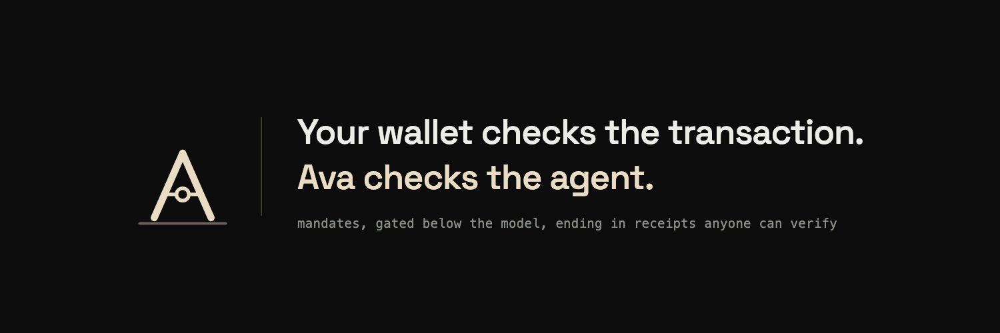
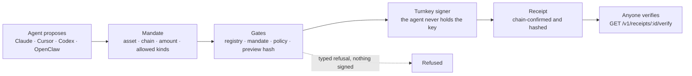

<p align="center">
  
</p>

# Ava

**Give any AI agent a wallet it cannot drain.** Ava is the execution layer for agents that do DeFi: mandates the agent cannot widen, gates that sit below the model, and receipts that anyone can check against the chain.

[getava.xyz](https://getava.xyz) · [Litepaper](https://getava.xyz/litepaper) · [Install](https://getava.xyz/install) · [X](https://x.com/avatheaiagent) · [Telegram](https://t.me/avatheaiagent) · [Discord](https://discord.gg/SyQsE8UgA)

## The problem, and what Ava does

An AI agent can ship an app, run research, book a flight. Ask it to supply 300 USDC to Morpho on Base and you get an explanation, some code, and no transaction. Hand it a key and you get a transaction and a new problem: nothing between the model and the money.

Ava is the part that can, and the part that holds the line. Claude Code, Cursor, Codex and OpenClaw connect over MCP. They never hold the key. Nothing spends outside a mandate. A receipt without chain-confirmed standing is not a fill.

- **Caps the model cannot widen.** A mandate names the asset, the chain, the amount and the allowed kinds. Those bytes are hashed at creation and the hash is carried inside what the signer commits to.
- **A preview the agent cannot skip.** The first execute call never fills. It returns the exact artifact and a `previewHash`, and refuses. Only a re-send carrying that hash proceeds, so what is signed is what was previewed.
- **A receipt that grades itself.** `chain-confirmed`, `unconfirmed` or `no proof`. Only the chain-confirmed arm carries a transaction hash.
- **A wallet per agent.** Each agent instance gets its own Turnkey wallet and its own mandate. The receipt names which one spent.

## How it works

The agent proposes. Ava decides.



A failure at any gate returns a typed refusal with `filled: false`, and nothing is signed. The signer is constructed after the last gate and nowhere else. Every receipt can be re-read by anyone through a public endpoint that needs no credential.

## Confirmed on mainnet

Ava built the calldata, signed it with its own Turnkey key, broadcast it, and the chain confirmed it. Seven settlements across four chains, each re-read from a public RPC node on 2026-11-12: every one returned a success receipt (`0x1`) at the block shown, calling the contract named in the record.

| Chain | Venue | Action | Transaction | Block |
|---|---|---|---|---|
| Base | Morpho gtUSDCp | supply USDC | [`0x97b78540…36bbba`](https://basescan.org/tx/0x97b78540cd233446b83fffacbdf7ab7e514446f914268c1fae14d5429e36bbba) | 49315911 |
| Base | Morpho gtUSDCp | withdraw USDC | [`0xce4109e4…6b0a7f`](https://basescan.org/tx/0xce4109e49eaa780588d0569c8886211132eee12377a1d16f22ba8b6d176b0a7f) | 49327027 |
| Avalanche | Aave v3 | supply USDC | [`0x12990c11…f4209f`](https://snowtrace.io/tx/0x12990c11b1e8a7a7eff5e594823669a6778d2a6886474d29d7f5cf450bf4209f) | 92231544 |
| BNB Chain | Aave v3 | supply USDC | [`0x7737cf5c…08b9de`](https://bscscan.com/tx/0x7737cf5cb76d1d4ac8e39f3ea4098a173534c259fb854dbc7ac991872608b9de) | 114508635 |
| Monad | Aave v3 | supply USDC | [`0x50940c95…8715cf`](https://monadexplorer.com/tx/0x50940c9510bef0cb595ecaf2b40d57d4cfa04227b6568ded4ea0541abd8715cf) | 92954146 |
| Monad | Aave v3 | supply USDC | [`0x1b23c35d…628af7`](https://monadexplorer.com/tx/0x1b23c35d5c7c58746961777fdc9eb468823be549a3784869ff0d71b326628af7) | 93291520 |
| BNB Chain | SushiSwap via LI.FI | swap | [`0x14850931…de0542`](https://bscscan.com/tx/0x14850931f8eb6a8adb1687d3065396bb26c297ad2d321fadfe59b1e73ede0542) | 114518492 |

Read at chain head: Base block 56372096, Avalanche block 100088796, BNB Chain block 133112000, Monad block 121530517.

The Monad receipt `exec_lend_aave_62d2a6763c984af8be707a58` is also re-read by Ava's own public endpoint: [`GET /v1/receipts/exec_lend_aave_62d2a6763c984af8be707a58/verify`](https://api.getava.xyz/v1/receipts/exec_lend_aave_62d2a6763c984af8be707a58/verify).

## Chains and venues

Callable today through the authenticated API, read from the live capability registry at [`api.getava.xyz/v1/capabilities`](https://api.getava.xyz/v1/capabilities):

| Chain | Venue | Action |
|---|---|---|
| Base | Morpho Blue | lend |
| Avalanche | Aave v3 | lend |
| BNB Chain | Aave v3 | lend |
| Monad | Aave v3 | lend |
| Arbitrum One | Aave v3 | lend |

Each route runs through the same gates: registry, mandate, policy, preview hash, reservation, signature, receipt.

## Install

One command connects Claude Code, Cursor and Codex. It opens a session, writes the HTTP MCP config for each client and prints your Base address:

```bash
npx @getava-xyz/connect
```

Or add it by hand. Open a session first, then pass the bearer token it returns:

```bash
curl -sX POST https://api.getava.xyz/v1/users/session \
  -H 'content-type: application/json' -d '{}'
```

**Claude Code**

```bash
claude mcp add --transport http ava https://api.getava.xyz/mcp \
  --header "Authorization: Bearer <token>"
```

**Codex**

```bash
codex mcp add ava \
  --transport http \
  --url https://api.getava.xyz/mcp \
  --header "Authorization: Bearer <token>"
```

**Cursor** (`~/.cursor/mcp.json`, or `.cursor/mcp.json` per project)

```json
{
  "mcpServers": {
    "ava": {
      "url": "https://api.getava.xyz/mcp",
      "headers": { "Authorization": "Bearer <token>" }
    }
  }
}
```

**OpenClaw**

```bash
openclaw skills install @kamalbuilds/ava
```

**Any MCP client** points at `https://api.getava.xyz/mcp` over HTTP with the same bearer header. The live tool list includes `ava_provision_wallet`, `ava_create_mandate`, `ava_preview_tx`, `ava_lend_execute`, `ava_approve_execute`, `ava_portfolio` and `ava_get_receipt`. Machine-readable summary: [getava.xyz/llms.txt](https://getava.xyz/llms.txt).

## Business model

Pricing follows one rule: pay for proof.

- **Disclosed settlement fee.** Charged on receipts the chain confirms, invoiced from the receipt log and never taken out of the transaction, so Ava stays out of the funds path. A refused action costs nothing.
- **Free verification.** Receipt verification is public and free for anyone, with no credential.
- **Wallet plans.** Free gives one agent wallet with mandates, policy gates, the preview hash, public receipts, MCP and REST. Pro adds isolated multi-agent budgets and standing authorizations. Fund adds a retained receipt archive, signed audit export and team seats. Enterprise adds a dedicated signer organisation and an SLA.
- **Audit export.** A hosted, retained, queryable receipt record for whoever has to answer for the capital: an auditor, an allocator, a compliance function.

Ava does not take custody of user funds and does not sell agent activity data.

## Litepaper

*A mandate-bounded execution layer for autonomous agents.* The formal model, the five constructions and the security games behind Ava, with 15 diagrams, by Kamal Nayan Singh and Aarav Raj.

- [Read the litepaper](https://getava.xyz/litepaper)
- [Litepaper PDF](https://getava.xyz/ava-litepaper.pdf)
- [Pitch deck PDF](https://getava.xyz/ava-pitch-deck.pdf)

## Repositories

- [**ava-the-ai-agent**](https://github.com/getava-xyz/ava-the-ai-agent): the public Ava agent repository.

## Community

- X: [@avatheaiagent](https://x.com/avatheaiagent)
- Telegram: [t.me/avatheaiagent](https://t.me/avatheaiagent)
- Discord: [discord.gg/SyQsE8UgA](https://discord.gg/SyQsE8UgA)
- LinkedIn: [Ava](https://www.linkedin.com/company/avatheaiagent/)

## Team

- **Kamal Nayan Singh**: [@kamalbuilds](https://github.com/kamalbuilds)
- **Aarav Raj**: [@aarav1656](https://github.com/aarav1656)
